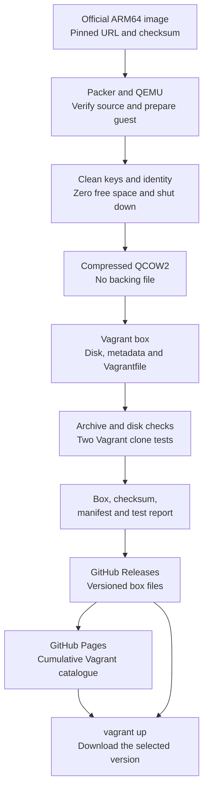

# Image Factory

Image Factory builds ARM64 Vagrant boxes with Packer and tests them on
GitHub Actions. Each target owns its source, preparation scripts and guest
checks. Releases include the box, checksum, build manifest, test report and
Vagrant catalogue.

| Target | Guest | Usage guide |
| --- | --- | --- |
| `debian-13-arm64` (default) | Debian 13 | [Debian README](targets/debian-13-arm64/README.md) |
| `ubuntu-26.04-arm64` | Ubuntu Server 26.04 LTS | [Ubuntu README](targets/ubuntu-26.04-arm64/README.md) |
| `windows-11-arm64` (build yourself) | Windows 11 Pro, lean installation | [Windows README](targets/windows-11-arm64/README.md) |

Debian and Ubuntu boxes are published in releases. The Windows recipe requires
your Microsoft ISO and produces a private box. Its guide explains how to build,
test and reference the local file in your own Vagrant project. Windows is not
included in release assets, public catalogues or GitHub image build matrices.

## Use a box on Apple Silicon

Install [Vagrant](https://developer.hashicorp.com/vagrant/install), QEMU and
the tested provider version:

```sh
brew install qemu
vagrant plugin install vagrant-qemu --plugin-version 0.6.3
```

Choose a target from the table above. Its README includes complete
`Vagrantfile` examples for one machine and two connected machines, with the
correct SSH account, native acceleration, resources and network options.

GitHub Pages serves the stable catalogues; their box files stay in GitHub Releases.
This follows Vagrant's [custom box repository format](https://developer.hashicorp.com/vagrant/docs/boxes/box_repository).
Each catalogue lists all published versions with `arm64` entries for `libvirt` and `qemu`.
Both entries use the same box file and SHA-256 checksum. To pin a version, set
`config.vm.box_version` to a release version such as `0.4.0`.
Vagrant downloads the catalogue and the selected box during `vagrant up`.

## From an official image to a tested box



Published Linux builds and guest tests use QEMU TCG on GitHub-hosted ARM64 runners.
The target usage guides use HVF for native acceleration on Apple Silicon.
Windows builds use HVF on the user's Apple Silicon host.
The box uses the libvirt archive format accepted by `vagrant-qemu`.

## Add an image

Follow the [Rocky Linux tutorial](docs/tutorials/add-rocky-linux.md) to create
an ARM64 target from an official cloud image and submit it for GitHub build
and runtime tests. The tutorial includes the source updater, guest preparation
and tests needed by a Linux target.

## Build and test tasks

```sh
task ci
task sources:update
task box:build
task test:box
```

The tasks use the default target from `targets.json`. Pass `TARGET=<target-name>`
to select another registered target.
`task ci` checks every registered recipe, including Windows configuration.
Build outputs are stored in
`dist/<target>/`; diagnostic logs are stored in `reports/`.

The [MIT license](LICENSE) covers the repository tools. Distribution packages
keep their own licenses.
